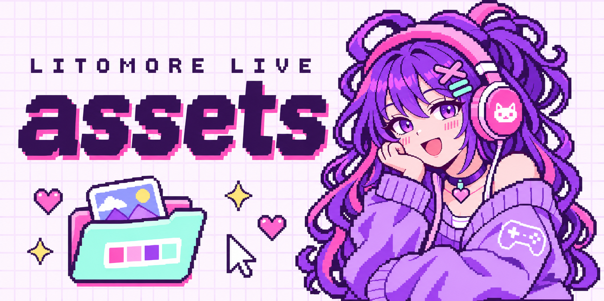

<h1 align="center">LitoMore Live Assets</h1>

角色形象、网页视觉与直播封面。

| 素材 | 尺寸 |
| --- | --- |
| [仓库封面](covers/repository/assets.png) | 1774 × 887 |
| [网页角色](characters/pixel-streamer/hero.webp) | 800 × 800 |
| [角色原图](characters/pixel-streamer/source.png) | 1254 × 1254 |
| [Voices 分享封面](covers/voices/opengraph.png) | 1200 × 630 |
| [Voices README 封面](covers/voices/readme.webp) | 1200 × 630 |
| [Voices 封面原图](covers/voices/source.png) | 1734 × 907 |
| [直播封面 · 4:3 主图](covers/live/open-source-maintenance-4x3.jpg) | 2048 × 1536 |
| [直播封面 · 16:9 居中裁切](covers/live/open-source-maintenance-16x9.jpg) | 1920 × 1080 |

直播封面的 16:9 版从 4:3 主图正中裁出（左右各 64、上下各 228 像素），重要信息均保留。

生成与编辑提示词见 [prompts/](prompts/)。

直播封面设计约定与可复用提示词见 [covers/live/README.md](covers/live/README.md)。

## License

[CC0 1.0 Universal](LICENSE)
